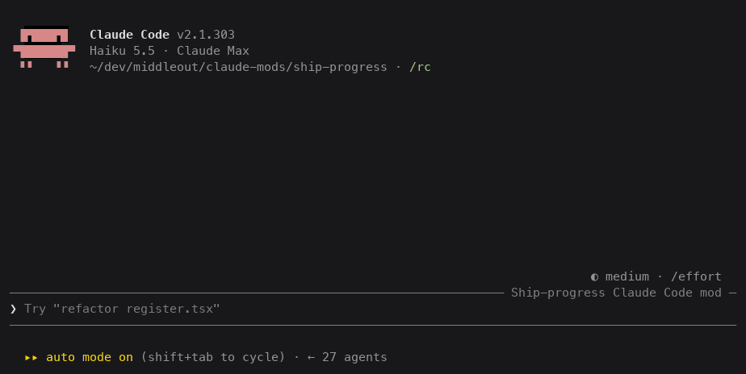

# ship-progress

A Claude Code mod that shows, above the prompt, where each pull request stands on its way to production:

```
#612 ■■■▣□  deploying (web) 4m 5e1f2a3b
#610 ■□□□□  awaiting merge 7m 33a1c9d0
#609 ■■■■■  live 8b7c6d5e
#605 ✕□□□□  PR CI failed 2m 41f0e2aa ⚠ CI / unit failed
```



It follows each PR through **PR CI → merged → main CI → deploys → custom checks**. It polls `gh` on a timer, so the agent doesn't spend turns watching CI, and it alerts when a stage fails or a PR goes live: it wakes the agent, raises a macOS notification, and posts to Slack if you configure a webhook.

**It only watches.** It never merges, reruns, retargets, cancels, approves or pushes. A CI guard (`scripts/check-watch-only.sh`) fails the build if its source ever names such a command.

## Install

At the prompt of a terminal session:

```
/plugin install ship-progress --marketplace toml0006/ship-progress
```

Answer `y` to add the marketplace, then pick a scope. From a shell: `claude plugin install ship-progress --marketplace toml0006/ship-progress`.

It needs the [GitHub CLI](https://cli.github.com/) signed in. The mod uses your `gh` as is and handles no tokens itself.

## Use

- `/track 608` (or `#608`, `owner/repo#608`, a PR URL) follows a PR. `/track` alone lists what is tracked and what shipped in the last 7 days.
- `/untrack 608` stops following it.
- PRs the session creates, merges, readies or pushes (`gh pr create`, `gh pr merge`, `gh pr ready`, `git push`) are tracked automatically.
- `/ship-progress` prints the status; `/ship-progress clear` drops task lists; `/ship-progress trust` approves this repo's custom checks (below).

The bar shows one line per PR or task list, most recent first, at most five. Pips: `■` passed, `▣` running, `□` pending, `✕` failed, `↷` superseded or skipped. It is hidden when nothing is in flight, and a finished PR stays visible for `doneLingerMinutes` (default 10).

### The agent tool

The model gets one tool, `ship_progress`, with an `action`:

| action | input | what it does |
|---|---|---|
| `track` / `untrack` | `{ pr }` | add or remove a PR |
| `annotate` | `{ pr, stage?, note }` | attach a short note to a PR or one of its stages |
| `add_step` | `{ pr, name, after? }` | add a step the agent owns to a PR's pipeline |
| `set_step` | `{ pr \| list, name, state, note? }` | set one of the agent's steps |
| `list_set` | `{ list, title, steps: [{ name, state?, after? }] }` | declare a task list with no GitHub involvement |
| `status` | `{}` | every track and list as JSON, so the agent never polls `gh` itself |

## Configure a repo

Commit `.claude/ship-progress.json` so everyone who installs the mod sees the same pipeline. Without it, PR CI is every check on the PR, main CI is every push-triggered workflow on the default branch, and there are no deploys or checks.

```json
{
  "$schema": "https://raw.githubusercontent.com/toml0006/ship-progress/main/schema/ship-progress.schema.json",
  "version": 1,
  "ci": { "workflow": "CI" },
  "deploys": [
    { "name": "web", "workflow": "Deploy web (staging)",
      "deployedSha": { "from": "log", "pattern": "HEAD is now at (\\w+)" } }
  ],
  "checks": [
    { "name": "workers drained", "argv": ["./scripts/check-drained.sh", "{mergeSha}"],
      "intervalSeconds": 60, "timeoutMinutes": 20 }
  ],
  "notify": { "macos": true, "wakeAgent": true, "slack": { "webhookEnv": "SHIP_PROGRESS_SLACK_WEBHOOK" } }
}
```

The full schema, with defaults, is in [`schema/ship-progress.schema.json`](schema/ship-progress.schema.json). A bad file falls back to the defaults and the bar says which field is wrong. To try a config before committing it, point `SHIP_PROGRESS_CONFIG` at a file anywhere.

### Deploys

A deploy passes when a run that started after the merge succeeds **and the commit it deployed contains the merge commit** (checked with `git merge-base --is-ancestor` in your clone, or GitHub's compare API).

- `"deployedSha": { "from": "headSha" }` trusts the run's `headSha`. Fine for push-triggered deploys.
- `"deployedSha": { "from": "log", "pattern": "…" }` reads the SHA from the run's log (the last match, capture group 1). Use it for `workflow_run` deploys, whose `headSha` is the branch tip, not necessarily what was deployed. Each run's log is fetched once and cached.
- A `cancelled` run (a concurrency group dropped it) shows as superseded and the stage keeps waiting. A `skipped` run is ignored: on `workflow_run` deploys most runs are skipped because CI finished on some other branch.
- Only a failed run whose deployed SHA contains the merge fails the stage. A deploy that never arrives fails after `timeoutMinutes` (default 45).

### Custom checks

Checks run after every deploy passed, from the repo root, with no shell: `argv` is the command, and `{mergeSha}`, `{prNumber}`, `{repo}` and `{deployedSha:<deploy>}` are filled in as whole arguments. Exit 0 is green; anything else retries every `intervalSeconds` until `timeoutMinutes`.

Because checks run commands from a committed file, they don't run until you type `/ship-progress trust` yourself. The mod refuses a trust that the agent or another plugin queued. The approval is a hash of the `checks` array, so any change asks again.

### Alerts

Alerts fire when a stage moves into a state listed in `notify.on` (default `failed`, `warning`, `done`), once per stage, state and run.

- **Wake the agent:** a short message is submitted to the session, so the agent can read the failing log without being asked.
- **macOS:** a notification through `osascript`.
- **Slack:** set the environment variable the config names (default `SHIP_PROGRESS_SLACK_WEBHOOK`) to an incoming-webhook URL before starting Claude Code. The URL is read from the environment only; it is never written to the config, the store or a log.

## How it stays cheap

Hooks only change state; the clock does the polling. Every 5 s the mod checks whether a poll is due: every 20 s while a stage runs, every 60 s while stages wait, never when nothing is tracked. Each poll handles at most 4 PRs. `gh` errors double the interval up to 5 minutes and show as `⚠ gh: …` on the bar. State is kept per repo in the plugin's store, so a new session resumes where the last one stopped.

## Differences from SPEC.md

- **Default CI.** With no `ci` set, PR CI is every check on the PR's head commit and main CI is every `push`-triggered workflow on the merge commit, rather than "the one workflow that runs on `pull_request`". It needs no workflow-file parsing and works for repos with several.
- **Skipped deploy runs** are ignored, not superseded (see Deploys).
- **No main CI.** With no `ci` set and no push run 10 minutes after the merge, main CI counts as skipped, so repos without branch CI still reach their deploys.
- **Merged before PR CI passed.** That stage is marked skipped with a note instead of blocking the rest of the pipeline.
- **Run logs** get a 20 s timeout instead of 8 s. They are large (around 150 KB), are read once per run, and are read on the clock, never in a hook.
- **A custom `webhookEnv` name** is read with `printenv`, because the mods API reads only environment variables named as literals in the source. The default name is read directly.

## Known limitations

- **Two sessions in one repo** each poll the same PRs and each send alerts, so you get every alert twice, and the session that saves last wins the stored state. Fixing this needs a lease shared between sessions through the plugin store.

## Development

```sh
claude --plugin-dir /path/to/ship-progress   # load it; edits reload when a turn ends
claude plugin validate .
claude plugin test .                         # 55 tests, gh answered from fixtures
scripts/check-watch-only.sh && scripts/check-public.sh
```

Type-check with `npx -p typescript tsc -p .` once Claude Code has loaded the mod and laid its typings in `.claude-plugin/types/`. [SPEC.md](SPEC.md) is the design.

## License

MIT
